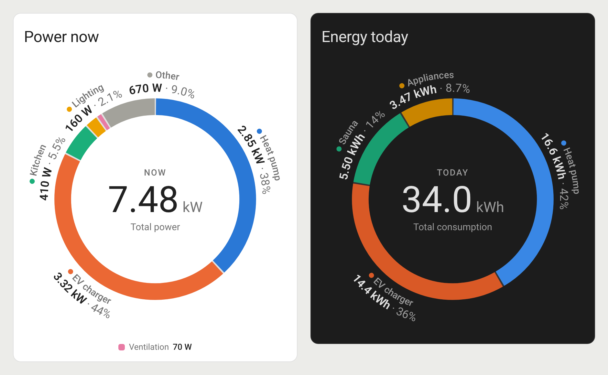

# Energy Ring Card

A Home Assistant Lovelace card that shows the total consumption in the middle of a ring. Each consumer is a segment, and its name, value and share are written **along the ring**.



- **Live power** (W/kW) or **energy from Home Assistant's long-term statistics**: today, yesterday, this week, month or year. No `utility_meter` helpers needed.
- Optional `total_entity`: the untracked remainder is shown as an **Other** segment.
- Labels are laid out automatically. Ones that don't fit on the ring move to a legend under it.
- Hover a segment to see its value and share in the centre. A click opens the more-info dialog. Works with the keyboard too.
- Light and dark theme and a colour-blind-safe default palette. Card texts follow the Home Assistant language (English, Finnish, Swedish).

Requires Home Assistant 2024.1 or newer.

## Installation

**HACS**

1. HACS → ⋮ → **Custom repositories** → URL `https://github.com/artepe/energy-ring-haos`, type **Dashboard** → Add.
2. Search for **Energy Ring Card**, download it and reload the browser.

**Manual**

1. Copy `energy-ring-card.js` to `/config/www/`.
2. Settings → Dashboards → ⋮ → **Resources** → Add resource: `/local/energy-ring-card.js?v=1.1.1`, type **JavaScript module**. (Resources is visible when *Advanced mode* is on in your user profile.)
3. Hard-refresh the browser.

## Examples

Power right now:

```yaml
type: custom:energy-ring-card
title: Power now
total_entity: sensor.shellypro3em_total_active_power
entities:
  - entity: sensor.heat_pump_power
    name: Heat pump
  - entity: sensor.tesla_wall_connector_power
    name: Tesla
  - entity: sensor.sauna_power
    name: Sauna
```

Energy today, read from the recorder statistics:

```yaml
type: custom:energy-ring-card
title: Energy today
period: today            # today | yesterday | week | month | year
total_entity: sensor.shellypro3em_total_active_energy
entities:
  - entity: sensor.heat_pump_energy
    name: Heat pump
  - entity: sensor.tesla_wall_connector_energy
    name: Tesla
```

## Options

| Option | Default | Description |
|---|---|---|
| `entities` | *required* | Entity IDs, or objects `{ entity, name, color }`. The first 8 get palette colours; a 9th+ entity without its own `color` is counted in *Other*. |
| `total_entity` | – | Value for the centre. Its difference to the sum of `entities` becomes the *Other* segment. Without it the centre shows the sum. |
| `period` | `live` | `live` = current state of the entities. `today`, `yesterday`, `week`, `month`, `year` = sum from long-term statistics. |
| `title` | – | Card header. |
| `show_other` | `true` | `false` leaves the untracked part of the ring empty instead of drawing *Other*. |
| `other_name` | *Other*, in the Home Assistant language | Name of the remainder segment. |
| `sort` | `false` | `true` = largest first, clockwise from the top. Default keeps the order of `entities`. |
| `legend` | `auto` | `auto` = only items whose label doesn't fit on the ring, `true` = all, `false` = none. |
| `decimals` | automatic | Force the number of decimals. |
| `center_label` | period or *Now* | Small text above the centre value. |
| `total_label` | *Total power* or *Total consumption* | Text below the centre value. |
| `refresh_interval` | `60` | Seconds between statistics refreshes (minimum 15). |
| `max_width` | `440` | Maximum width of the ring in pixels. |

`color` accepts any CSS colour, Home Assistant colour names (`orange`, `light-blue`, `primary`, …) or `[r, g, b]`.

Units W/kW/MW and Wh/kWh/MWh are converted and scaled automatically. Other units are shown as they are.

## Card size (sections view)

The card fills the cell it is given, like any other card:

```yaml
grid_options:
  columns: 6
  rows: 3
```

When the ring is smaller than about 280 px, it switches to a compact ring without the curved labels. Hover or tap a segment to see its name, value and share in the centre. With `legend: auto`, the legend is hidden when the cell is too short for both ring and legend. Set `legend: true` to keep it anyway.

## Statistics mode

With `period` set, the card sums the `change` of each sensor from the recorder: completed days in one request, today's completed hours, and the 5-minute statistics of the running hour. The numbers are at most a few minutes behind and refresh every `refresh_interval` seconds.

The sensors need `state_class: total` or `total_increasing` (the same sensors the Energy dashboard uses). Values are converted to kWh. A sensor without statistics is flagged in the legend and under the ring.

## Development

The tests run the card in headless Chromium against a mocked `hass` object and a simulated recorder.

```bash
cd tests
npm install                              # Roboto, for HA-accurate text measuring
pip install playwright && python3 -m playwright install chromium
python3 live_test.py                     # updates, hover, keyboard, timers, errors
python3 stats_test.py                    # statistics sums vs. ground truth (DST days, hour edges)
python3 intro_test.py                    # draw-in animation
python3 misc_test.py                     # unit handling, labels
python3 visual.py [dark]                 # screenshots to tests/out/
python3 size_test.py [dark]              # fixed sections-grid cells (grid_options)
xvfb-run -a python3 webkit_test.py       # same checks in WebKit, Safari's engine (apt: webkit2gtk-driver xvfb; pip: selenium)
python3 preview.py                       # regenerates images/preview.png
```

## License

MIT
